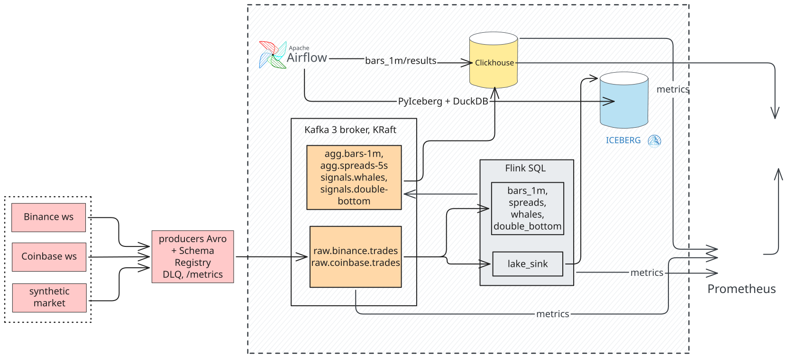
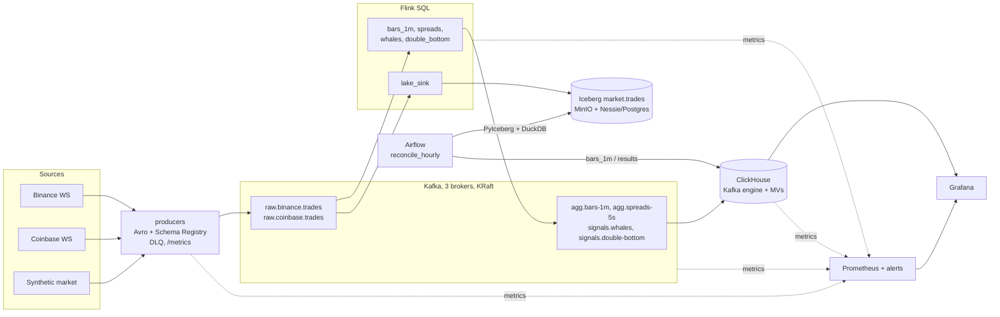

# Flux

**Real-time crypto market analytics on a local, production-shaped streaming data platform.**

[](https://github.com/annalhq/flux/actions/workflows/ci.yml)


Trades from Binance and Coinbase (or a seeded synthetic market) flow as Avro through Kafka into Flink
SQL jobs that build 1-minute OHLCV bars, cross-exchange spreads, whale alerts and double-bottom
patterns. Results are served from ClickHouse to Grafana, every raw trade lands in an Iceberg
lakehouse, and an hourly Airflow job proves that the streaming results equal a batch recomputation
**exactly**, window by window, or explains precisely where they differ.


## Highlights

- **Exactly-once, end to end:** idempotent producers → checkpointed Flink → transactional Kafka sinks → `read_committed` ClickHouse with idempotent `ReplacingMergeTree` keys.
- **Event-time stream processing in SQL:** watermarks with idle-source handling, window TVFs, a window join, and CEP with `MATCH_RECOGNIZE`.
- **Lambda-style verification without the lambda:** the lake is the source of truth, and a batch job reconciles it against the streaming output with zero tolerance.
- **Lakehouse:** Iceberg on MinIO with a versioned Nessie catalog, written by Flink and read by PyIceberg + DuckDB.
- **Data contracts:** Avro schemas in Schema Registry with BACKWARD compatibility enforced in tests, plus a dead-letter queue.
- **Operable:** one-command bring-up, health-gated startup, savepoint/checkpoint restore, Prometheus alerts, an end-to-end smoke test and CI.

## Contents

- [Architecture](#architecture)
- [Tech stack](#tech-stack)
- [Quickstart](#quickstart)
- [Streaming jobs](#streaming-jobs)
- [Data model](#data-model)
- [Delivery guarantees](#delivery-guarantees)
- [Reconciliation: streaming equals batch](#reconciliation-streaming-equals-batch)
- [Observability](#observability)
- [Screenshots](#screenshots)
- [Testing](#testing)
- [Repository layout](#repository-layout)
- [Known limitations](#known-limitations)
- [Roadmap](#roadmap)

## Architecture



<details>
<summary>Text version (Mermaid)</summary>



</details>

**Data flow**

1. **Ingest:** Python producers normalize exchange WebSocket trades (or a deterministic synthetic market) into Avro, register schemas, and publish to `raw.*.trades`. Messages that fail validation or delivery go to `dlq.producers` with their payload.
2. **Process:** Flink SQL jobs read both raw topics, compute aggregates and signals in event time, and write them to `agg.*` and `signals.*` topics transactionally.
3. **Land:** a separate Flink job appends every raw trade to the Iceberg table `market.trades`, committing once per checkpoint.
4. **Serve:** ClickHouse consumes the output topics through Kafka-engine tables and materialized views; Grafana queries ClickHouse.
5. **Verify:** Airflow recomputes each closed hour from the lake and compares it with ClickHouse, failing the DAG on any unexplained difference.

## Tech stack

| Layer | Technology | Role |
| --- | --- | --- |
| Ingestion | Python 3.11, `confluent-kafka`, `websockets` | Exchange clients, synthetic market, Avro serialization, DLQ |
| Messaging | Apache Kafka 3.7 (3 brokers, KRaft), Confluent Schema Registry 7.6 | Durable log, schema contracts |
| Stream processing | Apache Flink 1.19 (SQL) | Windowed aggregates, joins, CEP, lake sink |
| Lakehouse | Apache Iceberg, Nessie (Postgres-backed), MinIO | Raw trade history on object storage with a versioned catalog |
| Serving | ClickHouse 24.3 | Low-latency analytical store for dashboards and reconciliation |
| Orchestration | Apache Airflow 2.9, PyIceberg, DuckDB | Hourly batch recomputation and reconciliation |
| Observability | Prometheus 2.51, Grafana 10.4, kafka-exporter | Metrics, alert rules, dashboards |
| Tooling | Docker Compose, uv, ruff, pytest, GitHub Actions | Local platform, dependency management, CI |

## Quickstart

Requirements: Docker with Compose v2, [uv](https://docs.astral.sh/uv/), about 4 GB of free memory.

```bash
make demo        # fresh start: all services, topics, schemas, 5 Flink jobs, synthetic producers
make smoke       # end-to-end assertions (about 3-6 minutes after `make demo`)
```

Then open Grafana at http://localhost:3000 (dashboards **Flux / Market** and **Flux / Platform**;
anonymous viewing is on, admin password `admin`). The synthetic market starts two hours in the past and
replays at 120x until it reaches the present, so every panel has data within a couple of minutes.

| UI | URL |
| --- | --- |
| Grafana | http://localhost:3000 |
| Flink | http://localhost:8080 |
| Kafka UI | http://localhost:8090 |
| Airflow (`admin` / `admin`) | http://localhost:8082 |
| Prometheus | http://localhost:9090 |
| MinIO console (`minioadmin` / `minioadmin`) | http://localhost:9001 |
| Nessie | http://localhost:19120 |
| Producer metrics | http://localhost:8000/metrics |

Other commands:

| Command | Purpose |
| --- | --- |
| `make live` | Fresh start with live Binance and Coinbase trades |
| `make recon HOUR=2026-11-11T13` | Reconcile one closed hour (UTC) outside Airflow |
| `make lake-stats` | Iceberg row, partition and snapshot counts |
| `make jobs-status` | Flink job state and checkpoint health |
| `make jobs-down && make jobs` | Stop jobs with savepoints, then restore them |
| `make test lint` | Unit and contract tests, lint and format check |
| `make down` / `make clean` | Stop services, keeping or deleting volumes |
| `make help` | List every target |

Operations are described in [docs/runbook.md](docs/runbook.md); design decisions and everything
verified along the way are in [docs/decisions.md](docs/decisions.md).

## Streaming jobs

All jobs are plain Flink SQL rendered from one shared layer of settings, sources and views
([flink/sql](flink/sql)).

| Job | Technique | Output |
| --- | --- | --- |
| `bars_1m` | Event-time tumbling windows over a `UNION ALL` of both exchanges; watermarks with idle-source handling | 1-minute OHLCV with exact `volume`, `notional`, `trade_count` |
| `spreads` | Window join of two 5-second window aggregates (no unbounded join state) | Coinbase − Binance spread in bps |
| `whales` | Stateless filter on notional | Trades ≥ 250 000 |
| `double_bottom` | `MATCH_RECOGNIZE` over 1-minute bars with tolerance and depth rules | Pattern start, lows, neckline, breakout |
| `lake_sink` | Iceberg sink, commit per 60 s checkpoint, partitioned by `event_date, exchange` | `market.trades`, every raw trade |

## Data model

| Layer | Object | Notes |
| --- | --- | --- |
| Kafka (raw) | `raw.binance.trades`, `raw.coinbase.trades` | Avro, keyed for per-asset ordering; schemas in [producers/schemas](producers/schemas) |
| Kafka (derived) | `agg.bars-1m`, `agg.spreads-5s`, `signals.whales`, `signals.double-bottom` | Transactional Flink output |
| Kafka (errors) | `dlq.producers` | Rejected messages with payload and stage |
| Lake | `market.trades` (Iceberg) | Every raw trade, partitioned by `event_date, exchange` |
| Serving | `flux.bars_1m`, `flux.spreads_5s`, `flux.whale_trades`, `flux.double_bottoms` | `ReplacingMergeTree` on business keys, fed by Kafka engine + MVs |
| Quality | `flux.ingest_errors`, `flux.recon_runs`, `flux.recon_windows` | Malformed rows and reconciliation results |

## Delivery guarantees

| Hop | Mechanism | Guarantee |
| --- | --- | --- |
| Exchange → producer | WebSocket, reconnect with jittered backoff | At-most-once: gaps during disconnects cannot be replayed |
| Producer → Kafka | Idempotent producer, `acks=all`, `min.insync.replicas=2`; waits for its dependencies; failures to the DLQ with the payload | No duplicates from retries; durable once acknowledged; nothing silently dropped |
| Kafka → Flink | Source offsets in checkpoint state | Exactly-once processing state |
| Flink → Kafka (aggregates, signals) | Transactional sink, committed on checkpoint | Exactly-once, visible to `read_committed` consumers |
| Kafka → ClickHouse | Kafka engine + materialized views, `ReplacingMergeTree` on business keys; malformed rows to `flux.ingest_errors` | At-least-once ingest, effectively exactly-once under `FINAL` |
| Flink → Iceberg | Iceberg commit on checkpoint | Exactly-once per checkpoint |
| Upstream duplicates (exchange resends) | Kept in the raw data; counted by reconciliation; de-duplicated in ClickHouse whale keys | Measured, not hidden |

## Reconciliation: streaming equals batch

Every hour, `reconcile_hourly` recomputes each `(exchange, asset, 1-minute window)` from the Iceberg
lake (PyIceberg + DuckDB) and compares count, volume and notional with `flux.bars_1m` in ClickHouse.
There is no tolerance: decimals are exact end to end, so the measures are either equal or the
difference has a cause.

| Window status | Meaning |
| --- | --- |
| `MATCH` | Count, volume and notional equal |
| `LATE_DROPS` | The stream has fewer events: trades arrived after the watermark closed their window |
| `MISSING_STREAM` / `MISSING_BATCH` | The window exists on one side only |
| `STREAM_EXCEEDS_BATCH` | The stream has more than the lake: duplicates in serving or loss in the lake |
| `VALUE_MISMATCH` | Equal counts, different sums: corrupted values |

A run is `OK` when every window matches, `LATE_ONLY` when the only differences are late drops and
completeness is at least 99.9 %, and `FAILED` otherwise; a failed run fails the DAG. The run waits until
both sides provably contain the whole hour for every exchange and asset, so a slow consumer causes a
wait, not a false alarm.

With `SYNTH_LATE_RATIO=0` every window of every closed hour is `MATCH`. With the default ratio, the
synthetic market stamps 0.1 % of trades 30 s early; the hours come out `LATE_ONLY` and the windows that
lost trades are listed individually. Corrupting one bar in ClickHouse makes the DAG fail with
`STREAM_EXCEEDS_BATCH`.


## Observability

Producers, Kafka (via kafka-exporter), Flink and ClickHouse expose Prometheus metrics. Alert rules
cover silent producers, DLQ traffic and ingest latency, consumer lag and under-replicated partitions,
Flink job restarts, checkpoint failures and backpressure, and rows rejected by ClickHouse. Two provisioned Grafana dashboards show market data (**Flux / Market**) and platform
health (**Flux / Platform**).

## Screenshots

**Platform dashboard:** producers, Kafka, Flink and ClickHouse health


**Flink:** the five SQL jobs


**Airflow:** hourly reconciliation runs


**Kafka UI:** Avro trades decoded through Schema Registry


**MinIO:** Iceberg data files partitioned by `event_date` and `exchange`


## Testing

| Suite | What it covers | Needs infrastructure |
| --- | --- | --- |
| `tests/unit` | Exchange message parsing and decimal exactness; synthetic market determinism, scenario timing, late and duplicate ratios, and a Python port of the double-bottom pattern; WebSocket backoff; SQL rendering, restore paths; every reconciliation status and run rule | no |
| `tests/contract` | Avro schemas parse, decimals round-trip, BACKWARD compatibility with the previous version; every job renders with unique transactional ids and exactly-once sinks; compose images pinned, variables documented, memory limits set, no Docker socket | no |
| `scripts/smoke.py` | Services healthy, 5 jobs running, bars for all pairs, signals present, no ingest errors, Iceberg rows, last closed hour reconciles, Flink lag | yes (`make smoke`) |

CI runs lint, format check, unit and contract tests, `docker compose config`, and builds the three images.

## Repository layout

```
flux/
├── producers/          # Exchange clients, synthetic market, Avro schemas, DLQ (Python)
├── flink/
│   ├── submit.py       # Renders SQL, submits jobs, restores from checkpoints/savepoints
│   └── sql/            # common/ (settings, sources, views), jobs/, lake/ (Iceberg catalog)
├── airflow/
│   ├── dags/           # reconcile_hourly
│   └── flux_recon/     # Batch recomputation and comparison logic
├── infra/              # ClickHouse DDL, Flink/Airflow images, Grafana, Prometheus, Postgres
├── scripts/            # bootstrap (topics, schemas, DDL) and end-to-end smoke test
├── tests/              # unit/ and contract/ suites
├── docs/               # runbook, design decisions, images
├── docker-compose.yml
└── Makefile
```

## Known limitations

- `FIRST_VALUE` / `LAST_VALUE` follow arrival order, so a late trade that still makes its window can set
  that window's open or close (and the last price used for spreads). Additive measures are unaffected.
- A windowed job started fresh on a large backlog can drop data from the partitions its readers receive
  last (the watermark races ahead on the others). Jobs therefore start before producers and restore from
  checkpoints or savepoints; see the runbook.
- The JobManager has no high availability. A host restart stops the jobs; `make jobs` restores them from
  their last checkpoints.
- Spreads compare Binance USDT prices with Coinbase USD prices, so they include the USDT/USD basis.
- The lake commits one small file per partition per minute and has no compaction yet. Nessie keeps table
  history as commits, so Iceberg snapshot expiry does not apply.
- Trades that never reach Kafka (exchange gaps, dead-lettered messages) are invisible to reconciliation;
  the DLQ and producer alerts cover them.
- Sized for a laptop: on hosts with less than ~4 GB free, memory pressure can stall Kafka.

## Roadmap

- A normalizer job writing a canonical `trades` topic, so downstream jobs and the lake read one stream.
- An event-time arg-max aggregate for open, close and last price.
- Alertmanager with a webhook receiver; reconciliation results as Prometheus metrics.
- Iceberg compaction through the Flink SQL Gateway, and Nessie GC.
- A schema-evolution demo: add an optional field and show the BACKWARD check, Flink and the lake keep working.
- Coinbase level-2 order book for real bid/ask spreads.
