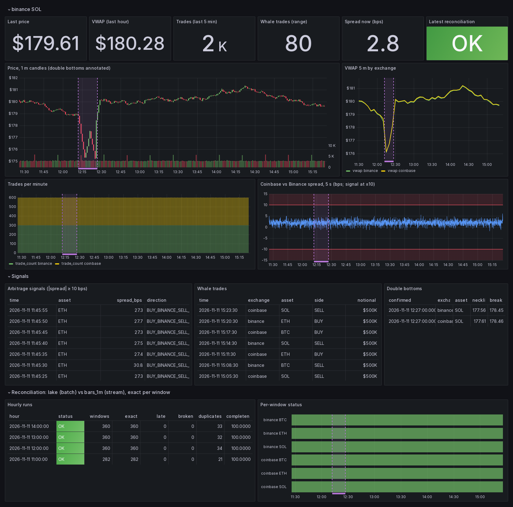
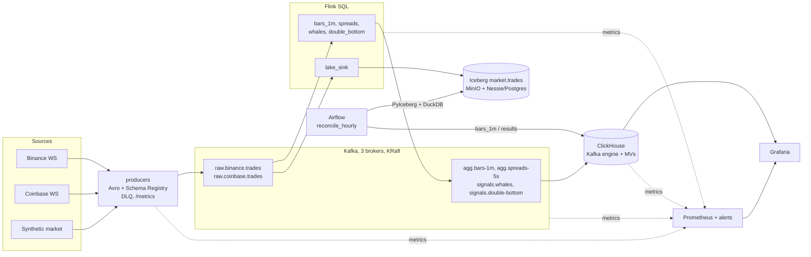
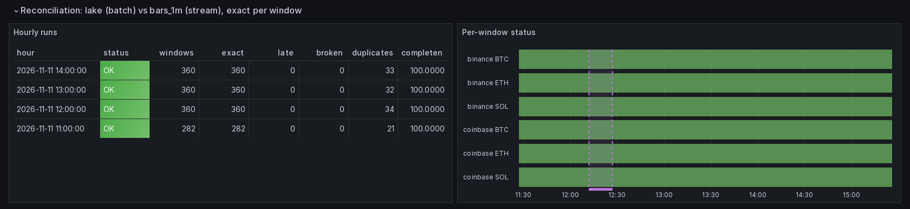
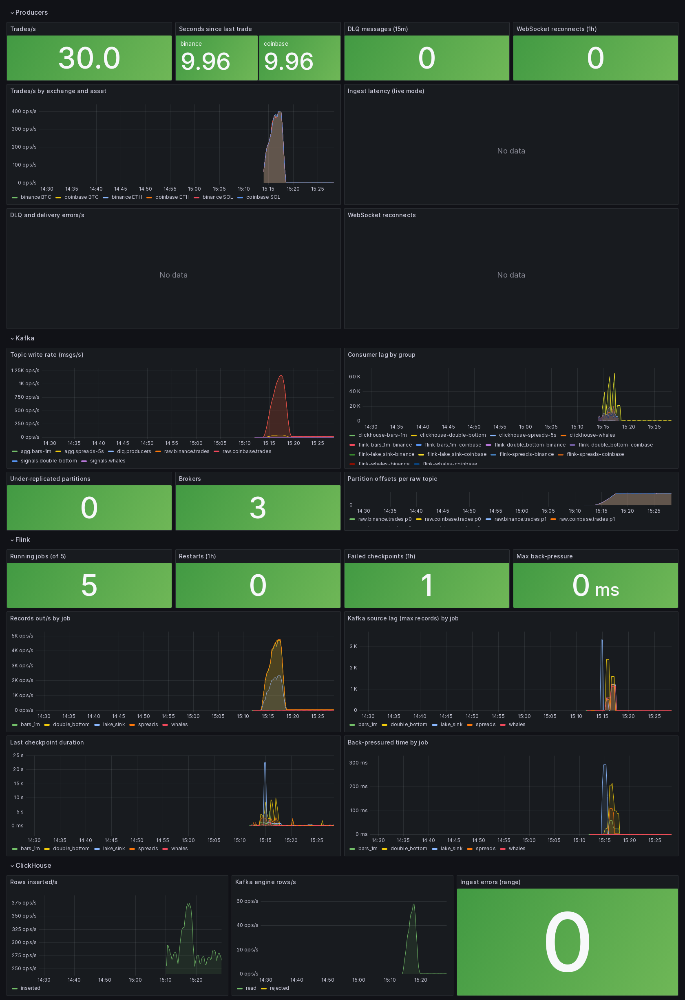
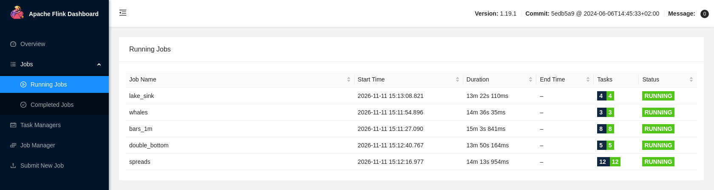
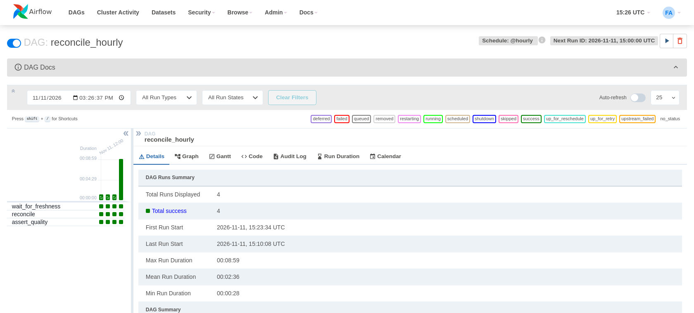
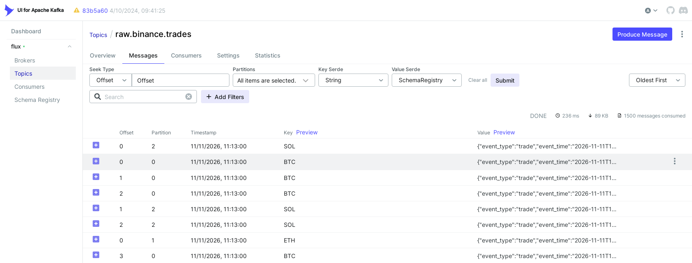
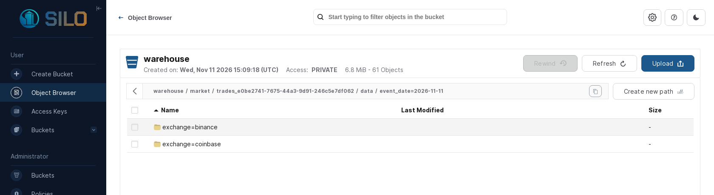

# Flux

Real-time crypto market analytics on a local, production-shaped data platform. Trades from Binance
and Coinbase (or a seeded synthetic market) flow as Avro through Kafka into Flink SQL jobs that build
1-minute OHLCV bars, cross-exchange spreads, whale alerts and double-bottom patterns. Results are
served from ClickHouse to Grafana, every trade lands in an Iceberg lakehouse, and an hourly Airflow
job proves that the streaming results equal the batch recomputation **exactly**, window by window,
or explains precisely where they differ.



## Quickstart

Requirements: Docker with Compose v2, [uv](https://docs.astral.sh/uv/), about 4 GB of free memory.

```bash
make demo        # fresh start: all services, topics, schemas, 5 Flink jobs, synthetic producers
make smoke       # end-to-end assertions (about 3-6 minutes after `make demo`)
```

Then open Grafana at http://localhost:3000 (dashboards **Flux / Market** and **Flux / Platform**;
anonymous viewing is on, admin password `admin`). The synthetic market starts two hours in the past and
replays at 120x until it reaches the present, so every panel has data within a couple of minutes.

| UI | URL |
| --- | --- |
| Grafana | http://localhost:3000 |
| Flink | http://localhost:8080 |
| Kafka UI | http://localhost:8090 |
| Airflow (`admin` / `admin`) | http://localhost:8082 |
| Prometheus | http://localhost:9090 |
| MinIO console (`minioadmin` / `minioadmin`) | http://localhost:9001 |
| Nessie | http://localhost:19120 |
| Producer metrics | http://localhost:8000/metrics |

Other entry points: `make live` (live exchange data), `make recon HOUR=2026-11-11T13`,
`make lake-stats`, `make jobs-status`, `make jobs-down && make jobs` (savepoint round trip),
`make test lint`. Operations are described in [docs/runbook.md](docs/runbook.md); design decisions and
everything verified along the way are in [docs/decisions.md](docs/decisions.md).

## Architecture



| Job | Technique | Output |
| --- | --- | --- |
| `bars_1m` | Event-time tumbling windows over a `UNION ALL` of both exchanges; watermarks with idle-source handling | 1-minute OHLCV with exact `volume`, `notional`, `trade_count` |
| `spreads` | Window join of two 5-second window aggregates (no unbounded join state) | Coinbase − Binance spread in bps |
| `whales` | Stateless filter on notional | Trades ≥ 250 000 |
| `double_bottom` | `MATCH_RECOGNIZE` over 1-minute bars with tolerance and depth rules | Pattern start, lows, neckline, breakout |
| `lake_sink` | Iceberg sink, commit per 60 s checkpoint, partitioned by `event_date, exchange` | `market.trades`, every raw trade |

## What this demonstrates

1. **Event-time stream processing:** watermarks, idle sources, window TVFs, a window join, and CEP with `MATCH_RECOGNIZE`, all as plain SQL rendered from one shared layer ([flink/sql](flink/sql)).
2. **Delivery semantics, end to end:** idempotent producers → exactly-once Flink → transactional Kafka → `read_committed` ClickHouse with idempotent `ReplacingMergeTree` keys (table below).
3. **Lakehouse:** Iceberg on object storage with a versioned catalog (Nessie, persisted in Postgres) read by Flink and PyIceberg through the same Iceberg REST endpoint.
4. **Data quality as a control, not a dashboard:** schema contracts with BACKWARD compatibility, a dead-letter queue, and exact batch-versus-stream reconciliation that fails the pipeline when the numbers do not add up.
5. **Operability:** one-command bring-up, health-gated startup, idempotent deploys, automatic restore from checkpoints and savepoints, Prometheus alerts, dashboards.
6. **Engineering hygiene:** pinned versions everywhere, unit and contract tests that need no infrastructure, an end-to-end smoke test, CI.

## Delivery guarantees

| Hop | Mechanism | Guarantee |
| --- | --- | --- |
| Exchange → producer | WebSocket, reconnect with jittered backoff | At-most-once: gaps during disconnects cannot be replayed |
| Producer → Kafka | Idempotent producer, `acks=all`, `min.insync.replicas=2`; waits for its dependencies; failures to the DLQ with the payload | No duplicates from retries; durable once acknowledged; nothing silently dropped |
| Kafka → Flink | Source offsets in checkpoint state | Exactly-once processing state |
| Flink → Kafka (aggregates, signals) | Transactional sink, committed on checkpoint | Exactly-once, visible to `read_committed` consumers |
| Kafka → ClickHouse | Kafka engine + materialized views, `ReplacingMergeTree` on business keys; malformed rows to `flux.ingest_errors` | At-least-once ingest, effectively exactly-once under `FINAL` |
| Flink → Iceberg | Iceberg commit on checkpoint | Exactly-once per checkpoint |
| Upstream duplicates (exchange resends) | Kept in the raw data; counted by reconciliation; de-duplicated in ClickHouse whale keys | Measured, not hidden |

## Reconciliation: streaming equals batch

Every hour, `reconcile_hourly` recomputes each `(exchange, asset, 1-minute window)` from the Iceberg
lake (PyIceberg + DuckDB) and compares count, volume and notional with `flux.bars_1m` in ClickHouse.
There is no tolerance: decimals are exact end to end, so the measures are either equal or the
difference has a cause.

| Window status | Meaning |
| --- | --- |
| `MATCH` | Count, volume and notional equal |
| `LATE_DROPS` | The stream has fewer events: trades arrived after the watermark closed their window |
| `MISSING_STREAM` / `MISSING_BATCH` | The window exists on one side only |
| `STREAM_EXCEEDS_BATCH` | The stream has more than the lake: duplicates in serving or loss in the lake |
| `VALUE_MISMATCH` | Equal counts, different sums: corrupted values |

A run is `OK` when every window matches, `LATE_ONLY` when the only differences are late drops and
completeness is at least 99.9 %, and `FAILED` otherwise; a failed run fails the DAG. The run waits until
both sides provably contain the whole hour for every exchange and asset, so a slow consumer causes a
wait, not a false alarm.

With `SYNTH_LATE_RATIO=0` every window of every closed hour is `MATCH`. With the default ratio, the
synthetic market stamps 0.1 % of trades 30 s early; the hours come out `LATE_ONLY` and the windows that
lost trades are listed individually. Corrupting one bar in ClickHouse makes the DAG fail with
`STREAM_EXCEEDS_BATCH`.



## Screenshots

| | |
| --- | --- |
| **Platform**: producers, Kafka, Flink and ClickHouse health  | **Flink**: the five SQL jobs  |
| **Airflow**: hourly reconciliation runs  | **Kafka UI**: Avro trades decoded through Schema Registry  |
| **MinIO**: Iceberg data files partitioned by `event_date` and `exchange`  | |

## Testing

| Suite | What it covers | Needs infrastructure |
| --- | --- | --- |
| `tests/unit` | Exchange message parsing and decimal exactness; synthetic market determinism, scenario timing, late and duplicate ratios, and a Python port of the double-bottom pattern; WebSocket backoff; SQL rendering, restore paths; every reconciliation status and run rule | no |
| `tests/contract` | Avro schemas parse, decimals round-trip, BACKWARD compatibility with the previous version; every job renders with unique transactional ids and exactly-once sinks; compose images pinned, variables documented, memory limits set, no Docker socket | no |
| `scripts/smoke.py` | Services healthy, 5 jobs running, bars for all pairs, signals present, no ingest errors, Iceberg rows, last closed hour reconciles, Flink lag | yes (`make smoke`) |

CI runs lint, format check, unit and contract tests, `docker compose config`, and builds the three images.

## Known limitations

- `FIRST_VALUE` / `LAST_VALUE` follow arrival order, so a late trade that still makes its window can set
  that window's open or close (and the last price used for spreads). Additive measures are unaffected.
- A windowed job started fresh on a large backlog can drop data from the partitions its readers receive
  last (the watermark races ahead on the others). Jobs therefore start before producers and restore from
  checkpoints or savepoints; see the runbook.
- The JobManager has no high availability. A host restart stops the jobs; `make jobs` restores them from
  their last checkpoints.
- Spreads compare Binance USDT prices with Coinbase USD prices, so they include the USDT/USD basis.
- The lake commits one small file per partition per minute and has no compaction yet. Nessie keeps table
  history as commits, so Iceberg snapshot expiry does not apply.
- Trades that never reach Kafka (exchange gaps, dead-lettered messages) are invisible to reconciliation;
  the DLQ and producer alerts cover them.
- Sized for a laptop: on hosts with less than ~4 GB free, memory pressure can stall Kafka.

## Next steps

- A normalizer job writing a canonical `trades` topic, so downstream jobs and the lake read one stream.
- An event-time arg-max aggregate for open, close and last price.
- Alertmanager with a webhook receiver; reconciliation results as Prometheus metrics.
- Iceberg compaction through the Flink SQL Gateway, and Nessie GC.
- A schema-evolution demo: add an optional field and show the BACKWARD check, Flink and the lake keep working.
- Coinbase level-2 order book for real bid/ask spreads.
